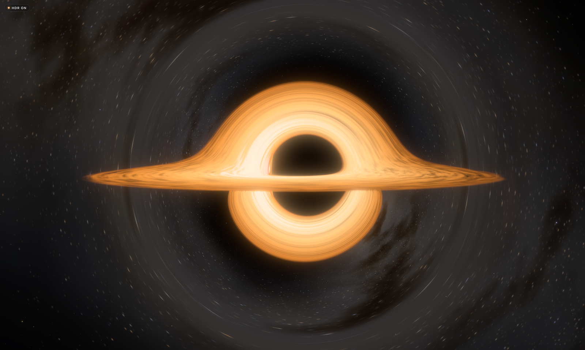
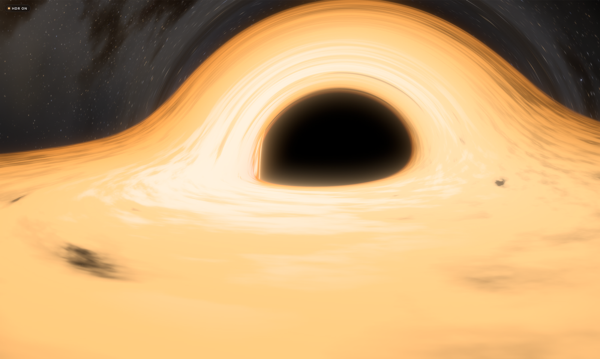

# Gargantua

**A real-time, physically based spinning black hole in a single HTML file.**

Gargantua renders a rotating (Kerr) black hole with a glowing accretion disk and a lensed starfield, in the style of the black hole from *Interstellar*. Every pixel traces a light ray backward through curved spacetime, so the shadow, the disk arching over and under the hole, the thin photon ring and the warped stars all come out of the physics rather than being painted in. On an HDR display the inner disk glows well past normal screen white.

  
  

## Try it

- **Online:** https://seawolf0.github.io/Gargantua/
- **Offline:** download [`index.html`](index.html) and open it in a browser. There's no install, no build step and no internet connection needed.

For the full experience, use a browser with WebGPU (Chrome works best) on an HDR display. Other browsers fall back to a WebGL2 renderer that runs the same physics in SDR.

## Features

- **Kerr geodesic ray tracing:** a light ray per pixel, integrated with RK4 in Cartesian Kerr–Schild coordinates with step sizes that shrink near the hole. Spin is adjustable from 0 (non-rotating) to 0.998.
- **Physically based accretion disk:** the inner edge sits at the innermost stable circular orbit (ISCO) for the current spin, and brightness follows the Page–Thorne flux profile. The gas orbits at the Keplerian rate and shows animated, differentially rotating turbulence.
- **Blackbody color:** disk color comes from the Planck spectrum integrated against the CIE 1931 color-matching functions, shifted by the gravitational and Doppler redshift of every point.
- **Two render modes:**
  - **Cinematic:** gravitational redshift only, like the film.
  - **Physical:** full Doppler beaming, so the side of the disk coming toward you is brighter and bluer.
- **Secondary images and photon ring:** rays can cross the disk several times, which gives the image of the disk wrapped over the top and under the bottom of the shadow.
- **Lensed sky:** a procedural starfield and Milky Way, bent around the hole into an Einstein ring.
- **HDR output:** WebGPU with an extended-range canvas, an adjustable HDR peak and energy-conserving multi-scale bloom. SDR displays get AgX tone mapping.
- **Fast:** geodesics are traced only when the camera or spin changes. Between those changes the cached rays are re-shaded every frame to animate the disk, and the image sharpens over time while the camera is at rest. A frame-rate governor adjusts resolution to keep motion smooth.
- **Accuracy self-check:** a diagnostics panel traces test rays and checks the results against known analytic values (shadow size and D-shape, photon sphere, ISCO, conservation of the ray's invariants), with pass/fail for each and a plot of the analytic shadow outline.
- **Single self-contained file:** plain HTML, CSS, JavaScript, WGSL and GLSL, with no libraries, images or network requests.

### Controls

| Input | Action |
| --- | --- |
| Drag | Orbit the camera |
| Scroll | Zoom in and out |
| 1–4 | Views: Interstellar · face-on · edge-on · close flyby |
| H | Control panel (spin, inclination, disk temperature, mode, exposure, bloom, HDR peak, quality) |
| D | Accuracy self-check |
| M | Switch between Cinematic and Physical |
| Space | Pause |

URL options: `?quality=low|medium|high|ultra`, `?backend=webgl2` (force the fallback), `?hdr=0` (force SDR), `?auto=0` (turn off the frame-rate governor).

## Version history

| Version | Changes |
| --- | --- |
| 1.0 | First release: real-time Kerr ray tracing, blackbody accretion disk with Cinematic and Physical modes, lensed procedural sky, HDR output with bloom, camera views, control panel, accuracy self-check and WebGL2 fallback. |

## How it was made

Gargantua started as a test of what Claude Fable 5.2 could build. Most of the code was generated by Fable 5.2 from prompts I designed and refined, working out the physics it had to get right (the Kerr metric, the disk model, blackbody color and redshift), the look I was after, the HDR output and the performance targets for running smoothly on a MacBook Pro.

From there I tested each version, dug into the code to track down bugs, fixed some of them by hand, and directed every change.

The physics follows Bardeen, Press & Teukolsky (1972), Novikov & Thorne (1973), Page & Thorne (1974), and James, von Tunzelmann, Franklin & Thorne (2015), the paper on the black hole renderings for *Interstellar*.

## License

All rights reserved for now.
